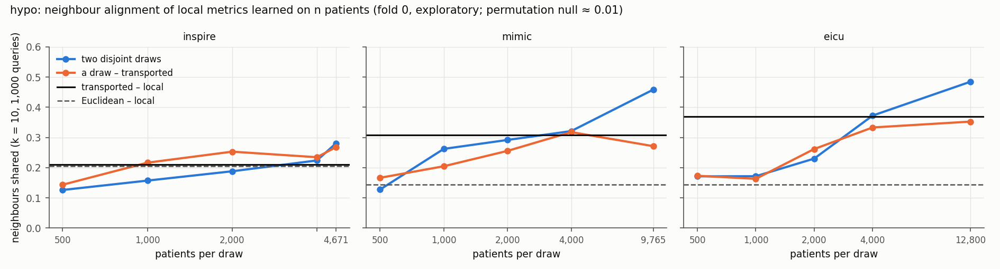

# Post hoc: do metrics learned apart retrieve the same neighbours? (exploratory)

Mutual k-nearest-neighbour alignment (Huh et al., 2024): the share of each query's k nearest neighbours that two metrics have in common, averaged over the queries. Plan: docs/DECISIONS.md 2026-11-04. In the case base: k = 50, a neighbour identified by its row, 95 % CI from 500 patient resamples. Within the sample (Huh et al.'s recipe): 1000 queries, k = 10, 20 draws, with the mean of a permutation null and the calibrated score (alignment − null) / (1 − null).

## `hypo` (fold 0)

| site | queries | case-base patients | chance, k = 50 |
|---|---|---|---|
| inspire | 2,288 | 9,343 | 0.0054 |
| mimic | 4,934 | 19,530 | 0.0026 |
| eicu | 6,431 | 25,601 | 0.0020 |

Reproduction: every metric with stage or ablation predictions reproduced them on the queries to 10⁻⁹; eicu's local but for 1 query (one vote, a float32 tie at the k-th neighbour, relative gap 4.0e-06).

| pair | inspire | mimic | eicu |
|---|---|---|---|
| transported – local, case base | 0.08 (0.08–0.08) | 0.14 (0.14–0.14) | 0.14 (0.14–0.15) |
| transported – local, within the sample | 0.21 (null 0.010; calibrated 0.20) | 0.31 (null 0.010; calibrated 0.30) | 0.37 (null 0.010; calibrated 0.36) |
| transported – local, prediction mean \|Δp\| / r | 0.045 / 0.781 | 0.066 / 0.906 | 0.048 / 0.895 |
| nhalf_a – nhalf_b, case base | 0.11 (0.11–0.11) | 0.17 (0.16–0.17) | 0.22 (0.21–0.22) |
| nhalf_a – nhalf_b, within the sample | 0.28 (null 0.010; calibrated 0.27) | 0.46 (null 0.010; calibrated 0.45) | 0.48 (null 0.010; calibrated 0.48) |
| nhalf_a – nhalf_b, prediction mean \|Δp\| / r | 0.042 / 0.793 | 0.058 / 0.922 | 0.045 / 0.903 |
| zscore+uniform – local, case base | 0.09 (0.08–0.09) | 0.05 (0.04–0.05) | 0.04 (0.03–0.04) |
| zscore+uniform – local, within the sample | 0.21 (null 0.010; calibrated 0.20) | 0.14 (null 0.010; calibrated 0.14) | 0.14 (null 0.010; calibrated 0.14) |
| zscore+uniform – local, prediction mean \|Δp\| / r | 0.053 / 0.735 | 0.100 / 0.797 | 0.073 / 0.814 |
| zscore+uniform – transported, case base | 0.09 (0.09–0.09) | 0.04 (0.04–0.04) | 0.05 (0.05–0.05) |
| zscore+uniform – transported, within the sample | 0.21 (null 0.010; calibrated 0.20) | 0.11 (null 0.010; calibrated 0.10) | 0.15 (null 0.010; calibrated 0.14) |
| zscore+uniform – transported, prediction mean \|Δp\| / r | 0.054 / 0.735 | 0.104 / 0.776 | 0.073 / 0.808 |
| transported – nhalf_a, case base | 0.12 (0.12–0.12) | 0.11 (0.11–0.12) | 0.12 (0.11–0.12) |
| transported – nhalf_a, within the sample | 0.27 (null 0.010; calibrated 0.26) | 0.27 (null 0.010; calibrated 0.26) | 0.35 (null 0.010; calibrated 0.35) |
| transported – nhalf_a, prediction mean \|Δp\| / r | 0.043 / 0.784 | 0.066 / 0.905 | 0.049 / 0.891 |
| local – nhalf_a, case base | 0.14 (0.14–0.15) | 0.22 (0.21–0.22) | 0.19 (0.19–0.19) |
| local – nhalf_a, within the sample | 0.31 (null 0.010; calibrated 0.30) | 0.51 (null 0.010; calibrated 0.51) | 0.46 (null 0.010; calibrated 0.45) |
| local – nhalf_a, prediction mean \|Δp\| / r | 0.042 / 0.795 | 0.056 / 0.926 | 0.046 / 0.906 |

Paired differences (case base, k = 50):

- inspire: transported|local − nhalf_a|nhalf_b: -0.030 (-0.033–-0.027); transported|local − zscore+uniform|local: -0.007 (-0.010–-0.004)
- mimic: transported|local − nhalf_a|nhalf_b: -0.024 (-0.027–-0.021); transported|local − zscore+uniform|local: 0.097 (0.094–0.099)
- eicu: transported|local − nhalf_a|nhalf_b: -0.073 (-0.076–-0.070); transported|local − zscore+uniform|local: 0.109 (0.107–0.111)

### n: two disjoint draws of n training patients

| n | inspire: draws a–b / a–transported / a–local | mimic: draws a–b / a–transported / a–local | eicu: draws a–b / a–transported / a–local |
|---|---|---|---|
| 500 | 0.05 / 0.06 / 0.04 | 0.03 / 0.05 / 0.06 | 0.04 / 0.04 / 0.03 |
| 1000 | 0.05 / 0.07 / 0.09 | 0.08 / 0.07 / 0.11 | 0.04 / 0.03 / 0.04 |
| 2000 | 0.07 / 0.09 / 0.09 | 0.09 / 0.08 / 0.11 | 0.08 / 0.09 / 0.15 |
| 4000 | 0.10 / 0.11 / 0.14 | 0.11 / 0.13 / 0.20 | 0.15 / 0.12 / 0.21 |
| half | 0.11 / 0.12 / 0.14 | 0.17 / 0.11 / 0.22 | 0.22 / 0.12 / 0.19 |

### Architecture: the ablation's variants

| variant | inspire: log-loss / mean alignment | mimic: log-loss / mean alignment | eicu: log-loss / mean alignment |
|---|---|---|---|
| transported | 0.3208 / 0.20 | 0.5052 / 0.15 | 0.3943 / 0.17 |
| zscore+uniform | 0.3280 / 0.21 | 0.5295 / 0.15 | 0.4117 / 0.15 |
| zscore+nca | 0.3219 / 0.21 | 0.5042 / 0.17 | 0.3979 / 0.15 |
| neutral+uniform | 0.3262 / 0.16 | 0.5241 / 0.12 | 0.4047 / 0.13 |
| neutral+sage | 0.3209 / 0.18 | 0.5029 / 0.10 | 0.3948 / 0.13 |
| neutral+shap | 0.3208 / 0.26 | 0.5050 / 0.17 | 0.3947 / 0.20 |
| neutral+perm | 0.3208 / 0.24 | 0.5025 / 0.17 | 0.3938 / 0.20 |
| neutral+nca | 0.3184 / 0.22 | 0.5040 / 0.17 | 0.3936 / 0.19 |
| hvdm+uniform | 0.3283 / 0.21 | 0.5309 / 0.15 | 0.4117 / 0.14 |
| hvdm+nca | 0.3228 / 0.21 | 0.5039 / 0.15 | 0.3974 / 0.14 |
| shape+uniform | 0.3268 / 0.15 | 0.5194 / 0.10 | 0.4015 / 0.11 |
| shape+sage | 0.3209 / 0.18 | 0.5037 / 0.12 | 0.3947 / 0.14 |
| shape+shap | 0.3205 / 0.24 | 0.5048 / 0.16 | 0.3945 / 0.19 |
| shape+perm | 0.3200 / 0.23 | 0.5036 / 0.16 | 0.3951 / 0.17 |
| Spearman (log-loss, mean alignment) | -0.57 | -0.28 | -0.65 |
| Spearman, within the sample | -0.71 | -0.31 | -0.81 |

Variant pairs (the transported one left out), mean within-sample alignment:

| the two variants share | pairs | inspire | mimic | eicu |
|---|---|---|---|---|
| weights | 12 | 0.50 | 0.56 | 0.53 |
| geometry | 18 | 0.37 | 0.28 | 0.35 |
| neither | 48 | 0.27 | 0.21 | 0.24 |

## T2

| site | queries | case-base stays | chance, k = 50 |
|---|---|---|---|
| mimic | 4,963 | 19,274 | 0.0026 |
| eicu | 4,725 | 18,463 | 0.0027 |

| pair | mimic | eicu |
|---|---|---|
| frozen – frozen_lookup, case base | 1.00 (1.00–1.00) | 1.00 (1.00–1.00) |
| frozen – frozen_lookup, within the sample | 1.00 (null 0.010; calibrated 1.00) | 1.00 (null 0.010; calibrated 1.00) |
| frozen – local, case base | 0.25 (0.25–0.25) | 0.21 (0.21–0.21) |
| frozen – local, within the sample | 0.30 (null 0.010; calibrated 0.30) | 0.26 (null 0.010; calibrated 0.25) |
| joint – local, case base | 0.28 (0.28–0.28) | 0.28 (0.28–0.29) |
| joint – local, within the sample | 0.34 (null 0.010; calibrated 0.34) | 0.33 (null 0.010; calibrated 0.32) |
| missing – local, case base | 0.27 (0.27–0.27) | 0.21 (0.21–0.22) |
| missing – local, within the sample | 0.32 (null 0.010; calibrated 0.32) | 0.27 (null 0.010; calibrated 0.26) |
| frozen – joint, case base | 0.43 (0.42–0.43) | 0.49 (0.49–0.49) |
| frozen – joint, within the sample | 0.50 (null 0.010; calibrated 0.49) | 0.55 (null 0.010; calibrated 0.54) |
| frozen – missing, case base | 0.82 (0.82–0.82) | 0.80 (0.80–0.80) |
| frozen – missing, within the sample | 0.84 (null 0.010; calibrated 0.84) | 0.82 (null 0.010; calibrated 0.82) |

Paired differences (case base, k = 50):

- mimic: joint|local − frozen|local: 0.031 (0.029–0.033); missing|local − frozen|local: 0.021 (0.020–0.022)
- eicu: joint|local − frozen|local: 0.074 (0.071–0.076); missing|local − frozen|local: 0.006 (0.005–0.007)

## `hypo` and T2 side by side (within the sample: the same n and k in both)

| experiment | site | transported – local | local – local, two halves | Euclidean – local | re-deformed – local |
|---|---|---|---|---|---|
| hypo | inspire | 0.21 (null 0.010; calibrated 0.20) | 0.28 (null 0.010; calibrated 0.27) | 0.21 (null 0.010; calibrated 0.20) | — |
| hypo | mimic | 0.31 (null 0.010; calibrated 0.30) | 0.46 (null 0.010; calibrated 0.45) | 0.14 (null 0.010; calibrated 0.14) | — |
| hypo | eicu | 0.37 (null 0.010; calibrated 0.36) | 0.48 (null 0.010; calibrated 0.48) | 0.14 (null 0.010; calibrated 0.14) | — |
| T2 | mimic | 0.30 (null 0.010; calibrated 0.30) | — | — | 0.34 (null 0.010; calibrated 0.34) |
| T2 | eicu | 0.26 (null 0.010; calibrated 0.25) | — | — | 0.33 (null 0.010; calibrated 0.32) |
