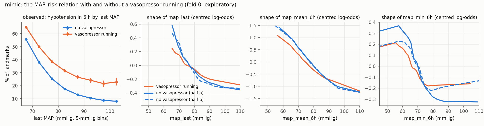
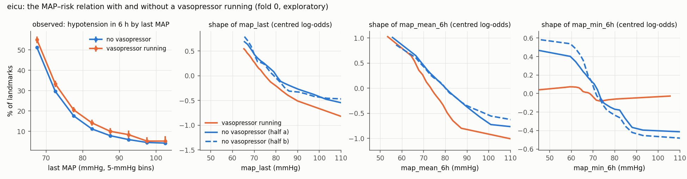

# `hypo` post hoc: the MAP–risk relation with and without a vasopressor running (exploratory)

Plan: docs/DECISIONS.md 2026-11-04. Fold 0's training landmarks. Shapes by S5's procedure on equal-size learning samples; r / slope = weighted correlation and slope of the first curve on the second (S5's comparison). Block: threshold (mmHg) and odds ratios of a steady MAP against 85 mmHg, consensus (median; 10–90 % over the 40 models).

## mimic

| group | landmarks (patients) | prevalence | block threshold | OR 70 vs 85 | OR 65 vs 85 |
|---|---|---|---|---|---|
| vasopressor running | 22,628 (8,687) | 46.8% | 75.1 (75.2; 73.7–78.9) | 3.6 (5.1; 4.3–5.6) | 6.3 (9.9; 8.9–12.8) |
| no vasopressor (half a) | 22,628 (9,127) | 32.1% | 78.1 (78.7; 76.7–79.9) | 6.2 (7.5; 5.4–8.7) | 16.3 (20.3; 13.4–38.2) |
| no vasopressor (half b) | 22,628 (9,130) | 33.0% | 77.4 (77.4; 76.1–79.6) | 6.3 (7.7; 6.0–10.2) | 12.6 (18.1; 10.4–27.5) |

| MAP summary | vaso – no-vaso a | vaso – no-vaso b | no-vaso a – b (noise) |
|---|---|---|---|
| map_last | 0.98 / 0.54 | 0.93 / 0.65 | 0.98 / 1.01 |
| map_mean_6h | 1.00 / 0.83 | 1.00 / 0.90 | 1.00 / 1.01 |
| map_min_6h | 0.97 / 0.56 | 0.96 / 0.79 | 0.98 / 1.41 |
| map_sd_6h | 1.00 / 0.56 | 1.00 / 0.61 | 0.99 / 1.07 |
| map_slope_6h | 0.99 / 0.59 | 0.98 / 0.65 | 0.98 / 1.16 |

Per-variable thresholds (consensus; median and 10–90 % over the models):

| group | map_last | map_mean_6h | map_min_6h |
|---|---|---|---|
| vasopressor running | nan (65.9; 65.6–66.7) | 72.4 (72.2; 71.0–77.7) | nan (57.5; 53.0–59.0) |
| no vasopressor (half a) | 66.5 (67.7; 66.9–68.8) | 75.1 (74.7; 71.7–79.4) | nan (66.2; 64.9–66.8) |
| no vasopressor (half b) | 65.8 (69.1; 66.2–70.8) | 75.2 (75.4; 72.3–79.8) | nan (62.8; 59.6–65.1) |

Observed rate of hypotension in the next 6 h by map_last (95 % CI):

| bin (mmHg) | no vasopressor | vasopressor running |
|---|---|---|
| 65–70 | 55.6% (55.0%–56.3%; n 38,780) | 65.1% (64.1%–66.1%; n 17,080) |
| 70–75 | 38.0% (37.4%–38.6%; n 46,350) | 50.0% (49.0%–51.1%; n 16,940) |
| 75–80 | 25.4% (24.8%–25.9%; n 44,200) | 38.5% (37.5%–39.7%; n 12,600) |
| 80–85 | 17.5% (17.0%–18.0%; n 36,880) | 31.4% (30.2%–32.7%; n 8,040) |
| 85–90 | 13.0% (12.5%–13.5%; n 27,320) | 26.5% (25.1%–28.0%; n 4,680) |
| 90–95 | 10.4% (9.9%–10.9%; n 19,300) | 24.2% (22.2%–25.8%; n 2,470) |
| 95–100 | 8.7% (8.1%–9.3%; n 12,660) | 21.6% (19.1%–23.9%; n 1,240) |
| ≥ 100 | 8.0% (7.5%–8.5%; n 18,730) | 22.9% (20.2%–25.9%; n 1,500) |

Observed rate of hypotension in the next 6 h by map_min_6h (95 % CI):

| bin (mmHg) | no vasopressor | vasopressor running |
|---|---|---|
| < 55 | 62.7% (60.9%–64.4%; n 6,190) | 72.8% (70.8%–75.0%; n 2,970) |
| 55–60 | 59.4% (58.3%–60.5%; n 14,490) | 68.0% (66.5%–69.4%; n 7,070) |
| 60–65 | 47.6% (46.9%–48.3%; n 34,990) | 58.2% (57.0%–59.3%; n 14,930) |
| 65–70 | 34.1% (33.4%–34.7%; n 57,110) | 44.6% (43.5%–45.7%; n 19,130) |
| 70–75 | 19.9% (19.4%–20.4%; n 47,160) | 30.7% (29.6%–32.0%; n 10,910) |
| 75–80 | 12.0% (11.5%–12.5%; n 33,080) | 21.6% (20.1%–23.1%; n 5,090) |
| 80–85 | 8.0% (7.5%–8.5%; n 21,600) | 19.6% (17.5%–21.3%; n 2,340) |
| 85–90 | 5.7% (5.3%–6.2%; n 13,140) | 16.8% (14.1%–19.6%; n 1,100) |
| 90–95 | 4.1% (3.6%–4.6%; n 7,940) | 12.7% (9.8%–16.1%; n 540) |
| 95–100 | 3.8% (3.2%–4.5%; n 4,260) | 13.6% (8.9%–19.2%; n 250) |
| ≥ 100 | 3.2% (2.7%–3.8%; n 4,270) | 12.7% (7.4%–19.5%; n 200) |

## eicu

| group | landmarks (patients) | prevalence | block threshold | OR 70 vs 85 | OR 65 vs 85 |
|---|---|---|---|---|---|
| vasopressor running | 10,677 (4,279) | 34.3% | 77.6 (78.7; 75.2–80.6) | 5.0 (7.4; 5.4–10.8) | 10.0 (21.6; 13.3–30.3) |
| no vasopressor (half a) | 10,677 (7,965) | 23.0% | 78.1 (79.3; 77.3–80.0) | 5.2 (7.7; 6.1–9.8) | 9.7 (19.2; 13.3–31.5) |
| no vasopressor (half b) | 10,677 (7,940) | 23.3% | 78.7 (79.7; 77.9–80.3) | 5.8 (8.6; 5.8–10.3) | 13.9 (25.6; 11.4–37.4) |

| MAP summary | vaso – no-vaso a | vaso – no-vaso b | no-vaso a – b (noise) |
|---|---|---|---|
| map_last | 1.00 / 1.15 | 0.94 / 1.14 | 0.94 / 1.04 |
| map_mean_6h | 0.98 / 1.23 | 0.99 / 1.35 | 1.00 / 1.08 |
| map_min_6h | 0.80 / 0.19 | 0.86 / 0.15 | 0.99 / 0.77 |
| map_sd_6h | 0.98 / 0.87 | 0.94 / 0.87 | 0.99 / 1.25 |
| map_slope_6h | 0.98 / 3.26 | 0.86 / 1.14 | 0.92 / 0.32 |

Per-variable thresholds (consensus; median and 10–90 % over the models):

| group | map_last | map_mean_6h | map_min_6h |
|---|---|---|---|
| vasopressor running | 69.3 (71.9; 70.2–73.7) | 73.5 (73.5; 68.0–79.4) | nan (58.4; 49.4–63.4) |
| no vasopressor (half a) | 68.8 (71.9; 69.9–73.4) | 69.1 (71.2; 69.6–78.0) | 55.9 (65.1; 61.2–71.2) |
| no vasopressor (half b) | 70.2 (70.9; 69.9–75.2) | 68.4 (72.2; 69.6–76.1) | 65.8 (66.9; 62.0–68.2) |

Observed rate of hypotension in the next 6 h by map_last (95 % CI):

| bin (mmHg) | no vasopressor | vasopressor running |
|---|---|---|
| 65–70 | 51.2% (50.5%–51.7%; n 45,020) | 55.0% (53.3%–56.5%; n 7,540) |
| 70–75 | 29.7% (29.1%–30.1%; n 56,810) | 33.3% (31.7%–34.8%; n 7,580) |
| 75–80 | 17.7% (17.2%–18.0%; n 56,810) | 20.6% (19.4%–22.0%; n 5,480) |
| 80–85 | 11.2% (10.9%–11.5%; n 52,200) | 14.2% (12.9%–15.8%; n 3,420) |
| 85–90 | 7.9% (7.6%–8.2%; n 42,010) | 10.1% (8.5%–11.6%; n 1,940) |
| 90–95 | 6.0% (5.7%–6.3%; n 31,880) | 8.4% (6.6%–10.3%; n 1,060) |
| 95–100 | 4.6% (4.3%–4.9%; n 22,210) | 5.3% (3.4%–7.2%; n 610) |
| ≥ 100 | 4.3% (4.0%–4.5%; n 37,560) | 5.2% (3.6%–7.6%; n 690) |

Observed rate of hypotension in the next 6 h by map_min_6h (95 % CI):

| bin (mmHg) | no vasopressor | vasopressor running |
|---|---|---|
| < 55 | 58.5% (56.8%–60.2%; n 5,650) | 59.0% (54.5%–63.2%; n 780) |
| 55–60 | 52.6% (51.5%–53.6%; n 13,840) | 57.3% (54.5%–60.2%; n 1,940) |
| 60–65 | 41.7% (40.9%–42.4%; n 35,880) | 47.0% (45.0%–48.8%; n 5,650) |
| 65–70 | 29.3% (28.8%–29.8%; n 65,740) | 33.5% (31.9%–35.1%; n 8,870) |
| 70–75 | 15.4% (15.0%–15.8%; n 65,000) | 19.0% (17.5%–20.5%; n 5,500) |
| 75–80 | 8.7% (8.4%–9.0%; n 52,220) | 9.8% (8.5%–11.2%; n 2,760) |
| 80–85 | 5.6% (5.3%–5.9%; n 40,030) | 5.4% (4.1%–6.9%; n 1,470) |
| 85–90 | 3.9% (3.6%–4.2%; n 26,830) | 3.6% (2.1%–5.2%; n 660) |
| 90–95 | 2.9% (2.6%–3.2%; n 17,440) | suppressed (n 340) |
| 95–100 | 2.3% (1.9%–2.6%; n 10,430) | suppressed (n 170) |
| ≥ 100 | 2.0% (1.7%–2.3%; n 11,440) | suppressed (n 170) |
